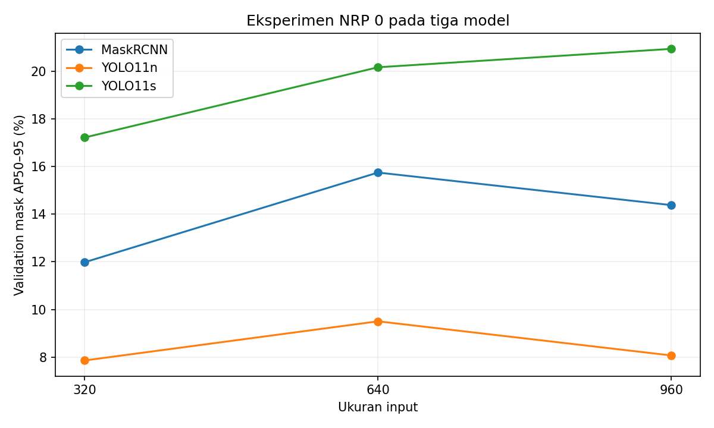

# Output Kaggle versi 4

Tabel dan grafik di halaman ini berasal dari evaluasi Kaggle versi 4 yang selesai pada 24 November 2026. Kolom AP dan AR dalam CSV memakai skala 0–1. Ringkasan di bawah memakai persen.

| Model | Mask AP50–95 uji asli, 640 | Mask AP50–95 uji HP, 640 | Mask AP50–95 validasi tertinggi |
|---|---:|---:|---:|
| YOLO11n-seg | 4,67% | 4,68% | 9,50% pada 640 piksel |
| YOLO11s-seg | 8,01% | 10,50% | 20,95% pada 960 piksel |
| Mask R-CNN | 6,80% | 9,39% | 15,75% pada 640 piksel |

- Uji asli berisi 359 foto dan uji HP berisi 40 foto. Tabel mencakup semua kelas, kelas yang memiliki contoh latih, dan 35 kelas yang muncul di kedua set uji serta memiliki contoh latih. [Perbandingan dua set uji](perbandingan_640.csv)
- Eksperimen NRP 0 menguji 320, 640, dan 960 piksel pada ketiga model. Skor checkpoint diukur pada 164 foto validasi. [Sembilan eksperimen resolusi](eksperimen_nrp_0.csv)
- Perbandingan pada epoch setara memakai log validasi dalam tiap model. YOLO memakai Ultralytics dan Mask R-CNN memakai COCOeval. [Hasil pada epoch setara](eksperimen_nrp_0_epoch_setara.csv)
- Dampak revisi label diukur pada 10 kelas bersama dengan foto dan prediksi yang sama. Draf rujukan uji HP berisi 352 mask dan masih perlu diperiksa di Roboflow. [Pengaruh revisi mask](dampak_revisi_mask_hp.csv)
- Selisih skor antara dua set uji dilaporkan dalam poin persentase. [Tabel domain shift](domain_shift.csv)
- Uji pada lima kasus kegagalan menggunakan checkpoint YOLO11n-seg yang sama pada tiga ukuran inferensi. [Angka uji lima kasus](uji_lima_kasus.csv)

## Grafik hasil

- [Grafik pada epoch setara](grafik/nrp_input_size_epoch_setara.png)
- [Kurva loss pelatihan](grafik/kurva_loss_training.png)

Kode yang dipakai untuk menjalankan evaluasi Kaggle versi 4 tersedia di repo ini. [Buka notebook sumber di GitHub](../notebooks/04-perbandingan-sembilan-run.ipynb)
