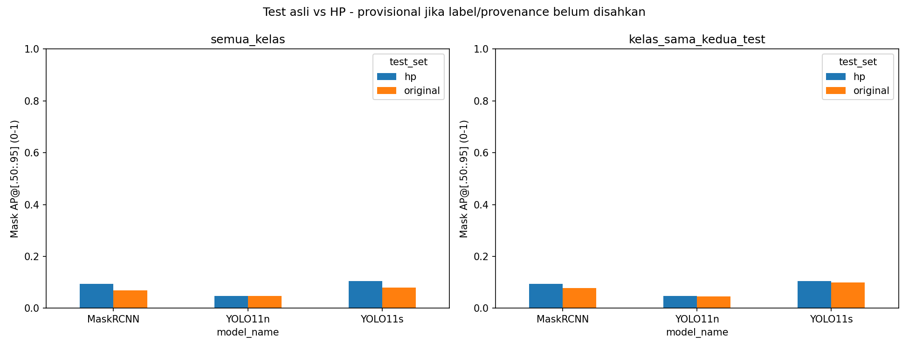

# Output Kaggle versi 4

Angka dan grafik ini diambil dari evaluasi Kaggle versi 4 yang selesai pada 24 November 2026. Tabel ringkas memakai persen. Di CSV, AP dan AR ditulis pada skala 0–1.

| Model | Mask AP50–95 uji asli, 640 | Mask AP50–95 uji HP, 640 | Mask AP50–95 validasi tertinggi |
|---|---:|---:|---:|
| YOLO11n-seg | 4,67% | 4,68% | 9,50% pada 640 piksel |
| YOLO11s-seg | 8,01% | 10,50% | 20,95% pada 960 piksel |
| Mask R-CNN | 6,80% | 9,39% | 15,75% pada 640 piksel |

- Ada 359 foto uji asli dan 40 foto uji HP. Tabel memuat skor semua kelas, skor kelas dengan contoh latih, dan skor untuk 35 kelas yang muncul di kedua set uji serta punya contoh latih. [Perbandingan dua set uji](perbandingan_640.csv)
- Untuk NRP 0, tiap model dicoba pada 320, 640, dan 960 piksel. Skornya dihitung dari 164 foto validasi. [Sembilan eksperimen resolusi](eksperimen_nrp_0.csv)
- Skor pada epoch yang sama diambil dari log validasi masing-masing model. YOLO memakai Ultralytics dan Mask R-CNN memakai COCOeval. [Hasil pada epoch setara](eksperimen_nrp_0_epoch_setara.csv)
- Pengaruh revisi label dihitung pada 10 kelas bersama dengan foto dan prediksi yang sama. Draf uji HP berisi 352 mask dan masih perlu dicek di Roboflow. [Pengaruh revisi mask](dampak_revisi_mask_hp.csv)
- Beda skor kedua set uji ditulis dalam poin persentase. [Tabel domain shift](domain_shift.csv)
- Lima foto dengan prediksi yang meleset diuji lagi pada tiga ukuran inferensi. Ketiganya memakai checkpoint YOLO11n-seg yang sama. [Angka uji lima kasus](uji_lima_kasus.csv)

## Grafik hasil

- [Grafik pada epoch setara](grafik/nrp_input_size_epoch_setara.png)
- [Kurva loss pelatihan](grafik/kurva_loss_training.png)

Kode untuk evaluasi versi 4 bisa dilihat di notebook ini. [Buka notebook sumber di GitHub](../notebooks/04-perbandingan-sembilan-run.ipynb)
