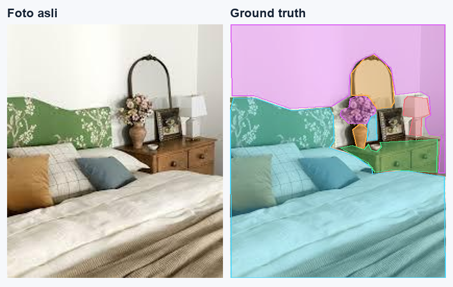
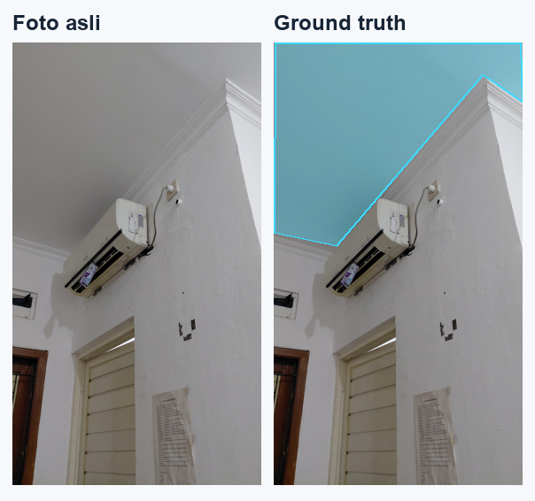
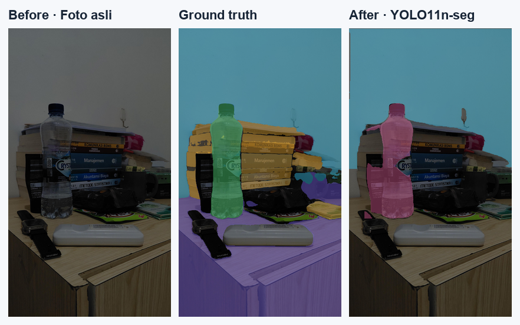
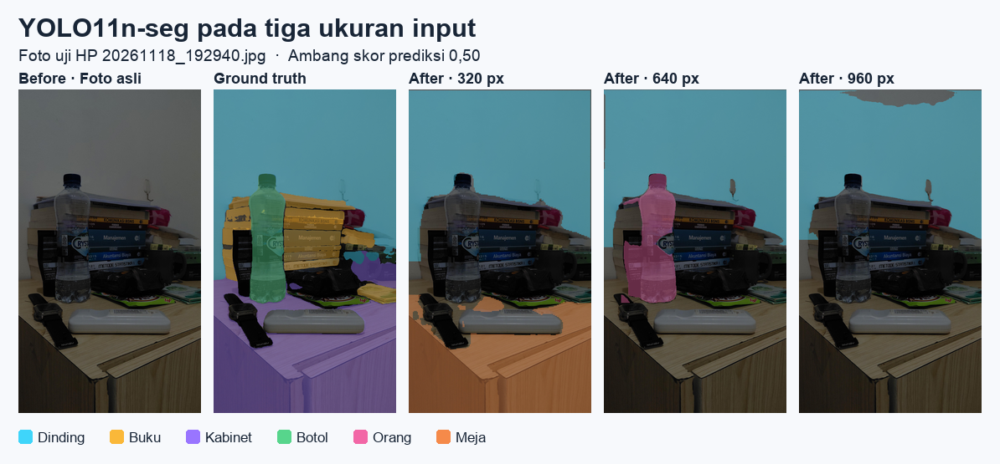

# Laporan CPMK3 · Segmentasi instance indoor

Proyek ini menguji pengaruh ukuran input terhadap kualitas mask objek di dalam ruangan. Rancangan percobaan membandingkan **YOLO11n-seg, YOLO11s-seg, dan Mask R-CNN ResNet-50 FPN** pada **320, 640, dan 960 piksel**. Tiga model dan tiga ukuran input menghasilkan sembilan kombinasi pelatihan.

[Laporan PDF sesuai rubrik](Visi_Komputer_Laporan_Chelsea_5054241010_Revisi.pdf) · [Daftar berkas submission](../README.md#berkas-submission)

## 1. Pengambilan foto dan persiapan data

Pengerjaan dimulai pada 17–19 November dengan pengambilan foto ruangan, persiapan anotasi di Roboflow, dan persiapan kode. Ekspor COCO v2 yang dipakai dalam evaluasi terdiri dari **395 foto latih, 164 foto validasi, 359 foto uji asli, dan 40 foto uji HP**. Empat gambar dari bagian latih dan validasi dikarantina karena dimensi file berbeda dari metadata COCO. Validasi dipakai untuk memilih checkpoint. Kedua set uji dipakai untuk evaluasi akhir. [Catatan data dan persiapan](../logbook/2026-11-23.md)

## 2. Anotasi dan contoh ground truth

Ground truth adalah polygon acuan yang menyatakan area objek yang seharusnya ditandai model. Dua contoh berikut dirender dari anotasi pada **ekspor COCO v2**. Panel kiri memperlihatkan foto sumber dan panel kanan menunjukkan mask acuan.

**Foto uji asli · `269.jpg`**

Foto ini memiliki delapan anotasi instance, termasuk tempat tidur, kabinet, dan dua instance yang berlabel cermin.

**Foto uji HP · `20261118_192916.jpg`**

Ekspor COCO v2 memuat satu polygon dinding dengan kelas `wall-other-merged`. Halaman 2 laporan PDF menunjukkan pengeditan polygon pada foto ini.

Audit anotasi pada 40 foto HP menambah 279 mask, mengoreksi 15 mask, dan mengeluarkan 21 anotasi di luar kelas acuan. Jumlah mask berubah dari 94 menjadi 352 pada draf revisi. Draf dibantu Codex dan Mask2Former dan masih memerlukan pemeriksaan di Roboflow. [Notebook audit](../notebooks/02-audit-revisi-mask-hp.ipynb) · [Laporan revisi PDF](Visi_Komputer_Laporan_Chelsea_5054241010_Revisi.pdf#page=2)

## 3. Hipotesis dan pelatihan

Pelatihan awal mencakup ketiga model pada 640 piksel serta YOLO11n pada 320 dan 960 piksel. Sebelum run tambahan YOLO11s dan Mask R-CNN pada 23 November, hipotesis yang dicatat adalah bahwa input lebih besar dapat mempertahankan detail objek kecil seperti buku dan steker. Pelatihan tambahan melengkapi matriks sembilan kombinasi. Ukuran 320, 640, dan 960 adalah parameter **input gambar**. Kualitas mask keluaran diukur dengan Mask AP50–95.

Pembagian data, seed 42, dan pengaturan pelatihan dijaga tetap di dalam tiap model saat ukuran input berubah. Jumlah epoch yang tercapai berbeda karena anggaran waktu pelatihan tiap model. Evaluasi juga memuat perbandingan pada epoch yang sama di dalam tiap model. [Hipotesis](../logbook/2026-11-23-hipotesis-run-tambahan.md) · [Log pelatihan](../bukti/log-training/) · [Hasil pada epoch setara](../hasil/eksperimen_nrp_0_epoch_setara.csv)

## 4. Pengujian yang sudah dilakukan

### Pengaruh resolusi pada validasi

Mask AP50–95 checkpoint terbaik pada 164 foto validasi. Angka dinyatakan dalam persen.

| Model | 320 px | 640 px | 960 px |
|---|---:|---:|---:|
| YOLO11n-seg | 7,86 | **9,50** | 8,07 |
| YOLO11s-seg | 17,22 | 20,18 | **20,95** |
| Mask R-CNN | 11,98 | **15,75** | 14,38 |

YOLO11s-seg pada 960 piksel mencapai skor validasi tertinggi dari sembilan kombinasi. Untuk YOLO11n-seg dan Mask R-CNN, skor tertinggi masing-masing dicapai pada 640 piksel. [Data sembilan eksperimen](../hasil/eksperimen_nrp_0.csv) · [Grafik validasi](../hasil/grafik/nrp_input_size.png)

### Perbandingan set uji asli dan set uji HP

Ketiga model dibandingkan pada ukuran input yang sama, **640 piksel**. Skor berikut adalah Mask AP50–95 untuk semua kelas dalam cakupan masing-masing set, dalam persen.

| Model | Uji asli · 359 foto | Uji HP · 40 foto |
|---|---:|---:|
| YOLO11n-seg | 4,67 | 4,68 |
| YOLO11s-seg | **8,01** | **10,50** |
| Mask R-CNN | 6,80 | 9,39 |

Tabel lengkap juga menyediakan cakupan 35 kelas bersama yang punya contoh latih, sehingga hasil pada kedua set bisa dibandingkan dengan cakupan kelas yang sama. [Perbandingan dua set uji](../hasil/perbandingan_640.csv) · [Selisih antardataset](../hasil/domain_shift.csv)

### Pengaruh revisi anotasi foto HP

Eksperimen ini memakai prediksi yang sama dan menghitung ulang skor terhadap anotasi awal dan draf revisi pada 10 kelas bersama. Mask AP50–95 naik **1,31 poin persentase** untuk YOLO11n-seg, **7,23 poin** untuk YOLO11s-seg, dan **7,25 poin** untuk Mask R-CNN. Selisih ini mengukur pengaruh perubahan anotasi pada evaluasi. [Tabel dampak revisi](../hasil/dampak_revisi_mask_hp.csv)

### Pengujian ulang lima kasus kegagalan

Lima foto yang prediksinya meleset diproses ulang pada ukuran inferensi 320, 640, dan 960 piksel memakai **checkpoint YOLO11n-seg yang sama**. Hasilnya dicatat sebagai deteksi yang cocok, objek yang terlewat, prediksi tambahan, dan rata-rata IoU mask yang cocok. Pada kasus 1, ukuran 960 menghasilkan 2 kecocokan dan 9 prediksi tambahan, sementara 320 menghasilkan 1 kecocokan dan 4 prediksi tambahan. [Tabel lima kasus](../hasil/uji_lima_kasus.csv) · [Lima studi kasus bergambar di halaman 5–6 PDF](Visi_Komputer_Laporan_Chelsea_5054241010_Revisi.pdf#page=5)

## 5. Before dan after prediksi model

### YOLO11n-seg · 640 piksel

Foto uji HP `20261118_192940.jpg` adalah salah satu dari lima kasus yang diuji ulang. Panel **Before** menampilkan foto sebelum inferensi, **Ground truth** menampilkan anotasi acuan, dan **After** menampilkan mask prediksi dari checkpoint terlatih dengan ambang skor 0,50.

Mask sian menandai dinding. Model juga memprediksi kelas `person` (merah muda, skor 0,66) pada area yang mencakup botol. Ground truth menandai botol dengan warna hijau dan buku dengan warna kuning. [Tabel lima kasus](../hasil/uji_lima_kasus.csv)

### YOLO11n-seg · Perbandingan ukuran input

Foto uji yang sama juga diproses pada 320 dan 960 piksel dengan checkpoint YOLO11n-seg yang sama. Di bawah ini ketiga prediksi ditampilkan dengan ambang skor 0,50. Warna yang sama menunjukkan kelas yang sama.

Pada foto ini, model menandai dinding pada ketiga ukuran. Prediksi tambahan berubah dari meja pada 320 piksel menjadi orang pada 640 piksel. Pada 960 piksel hanya mask dinding yang melewati ambang skor. [Tabel pengujian lima kasus](../hasil/uji_lima_kasus.csv)

## 6. Kesimpulan dan demo

Pilihan ukuran input bergantung pada model. **YOLO11s-seg 960** unggul pada validasi, sementara **YOLO11s-seg 640** unggul dalam perbandingan tiga model pada kedua set uji pada 640 piksel. Audit foto HP juga menunjukkan bahwa kelengkapan dan konsistensi anotasi memengaruhi skor yang dilaporkan.

Notebook demo menyediakan alur untuk memasukkan foto baru, memilih kelas dan ambang skor, serta melihat overlay prediksi mask. [Notebook demo](../notebooks/05-demo-foto-baru.ipynb) · [Langkah menjalankan demo](../README.md#menjalankan-demo-foto-baru)

Evaluasi versi 4 selesai pada 24 November 2026. Detail setelan dan sumber data untuk menjalankan evaluasi ulang tersedia pada README utama. [Cara menjalankan ulang](../README.md#menjalankan-ulang-evaluasi-di-kaggle) · [Notebook evaluasi](../notebooks/04-perbandingan-sembilan-run.ipynb)
